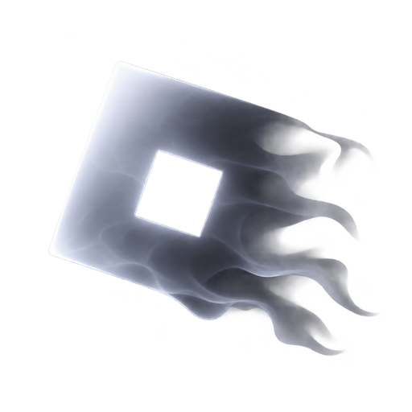

<div align="center">
  

# GhostStrap

### Roblox Player management for Windows, macOS, and Linux.

Install and update Roblox, tune local settings, manage modifications, and launch games from one desktop app.

**Avalonia UI** · **.NET 10** · **MPL-2.0 application base + MIT GhostStrap component**

</div>

---

> [!IMPORTANT]
> GhostStrap is a community rebuild based on Froststrap, which in turn identifies its source relationship to Fishstrap. It is not an official Froststrap or Fishstrap release. Branding changes do not change source licenses: MPL-covered code keeps its notices; the GhostStrap downloader integration is MIT-licensed. See [LICENSING.md](LICENSING.md).

## Features

This rebuild carries forward the working application areas from the source project:

| Area | Capabilities |
| --- | --- |
| Roblox deployment | Install, update, repair, and manage Player versions from Roblox deployment packages. |
| FastFlags | Edit, validate, save, and restore local FastFlag profiles and presets. |
| Mods | Manage local modifications, backups, presets, and Player or Studio targets supported by the client. |
| Launching | Quick Play, game shortcuts, protocol links, and launch options. |
| Servers and regions | Browse and filter servers and select regions where the relevant Roblox service supports them. |
| Studio | Detect Studio activity and provide Studio integrations. |
| Appearance | Themes, backgrounds, gradients, cursors, and window appearance settings. |
| Integrations | Discord Rich Presence and activity tracking. |
| Accounts | Account switching. Treat Roblox session credentials as private and only use this feature on a device you control. |

Roblox may change undocumented endpoints, launch formats, FastFlags, or client behavior. Some capabilities vary by operating system and Roblox version.

## Platform support

| Platform | Notes |
| --- | --- |
| Windows | Windows 10 LTSC or Windows 11 and later. x64 packaging is configured; ARM64 packaging still needs a verified native build. |
| macOS | x64 and Apple Silicon packaging are configured. Current CI uses macOS 26 runners. |
| Linux | Player runs through Wine; there is no native Linux Roblox desktop client. Wine and distribution support vary. |

The app includes native Rust libraries. A complete package build needs .NET 10, Rust, and the platform's native build tools.

## Downloads and releases

Use the repository's [Releases](../../releases) page after a release has been published. Action-run artifacts are temporary build downloads and are separate from GitHub Releases. Release workflows attach platform assets and a `SHA256SUMS` file.

The updater defaults to `GhostStrap/GhostStrap`. Set `GHOSTSTRAP_REPOSITORY` to `owner/repository` if your repo uses another owner or name. Public releases need no token. For a private repository, set `GHOSTSTRAP_GITHUB_TOKEN` to a fine-grained token with read-only access to that repository; the app reads it from the process environment and does not save or log it. Never commit a token to the source tree or share it in logs.

Remote community configuration still uses Froststrap's signed feed and public key because the supplied source archives do not include a GhostStrap feed or its signing keys. This upstream data dependency must be replaced before GhostStrap is an independent release.

## Build from source

Clone the repository with recursive submodules enabled, then run these from its root:

```sh
git clone --recurse-submodules <repository-url>
cd <repository-folder>
dotnet restore GhostStrap.slnx
dotnet build GhostStrap.slnx -c Release
```

For a managed-code compile that skips Rust library compilation:

```sh
dotnet build GhostStrap/GhostStrap.csproj -c Release -p:SkipNativeBackend=true
```

That managed-only build does not produce a runnable package with the native features enabled. The CI workflow compiles the managed solution on Windows, Linux, and macOS and uploads any test results.

## GitHub Actions

- **CI** runs on pushes and pull requests and checks the managed solution on all three desktop operating systems.
- **Debug Builds** creates downloadable development packages after each push.
- **Nightly** creates scheduled prerelease packages.
- **GhostStrap Release** runs for version tags. Manual release runs take an existing version tag as input. The workflow checks it against `<AppVersion>`, downloads all platform build artifacts, fails if assets are missing, creates SHA-256 checksums, and attaches the files to this repository's release.
- Release publication uses the repository-scoped `GITHUB_TOKEN`; it does not require a separate package-repository secret. macOS packages from these workflows are unsigned.

There are currently no automated test projects in this source tree. CI builds the managed solution on all three operating systems and runs any test projects added to the repository. The current automated checks do not replace a full native-toolchain build and end-to-end installation test on each operating system.

## Data and privacy

GhostStrap stores settings, cached packages, logs, profiles, and modification data locally. It contacts Roblox for deployment and game activity features, GitHub for release and configuration data, and the Discord desktop app when Rich Presence is enabled.

Account switching handles Roblox account credentials. Do not share session cookies, tokens, or diagnostic logs that may contain private data.

## Known limitations

- GhostStrap is not affiliated with Roblox Corporation.
- The rebuilt source has passed a managed-code compile on this workstation; the Rust native backend and signed installers have not been verified here because the required Rust toolchain is unavailable.
- Linux support depends on Wine and the selected Wine prefix.
- Community modifications are user-provided; review files before installing them.
- No release should be treated as verified until the platform Release workflow completes successfully.

## Contributing

See [CONTRIBUTING.rst](CONTRIBUTING.rst) before opening a pull request. Include reproduction steps and the operating system and architecture you tested. Never include Roblox credentials or session cookies in reports.

## Licensing

This source tree contains more than one license. Froststrap-derived files remain under MPL-2.0. The integrated parallel downloader from GhostStrap is under MIT. Third-party notices are in [LICENSES](LICENSES).
